# Kumizo

[](https://www.rust-lang.org)
[](https://wayland.freedesktop.org/)
[-green.svg)](https://github.com/zed-industries/zed)
[](https://github.com/noobmaisfier/kumizo/blob/main/LICENSE-MIT)

**Kumizo** (`kumizo-kit`) is a pure-Rust SDK for building your own Wayland desktop shell — status bars, docks, launchers, OSDs, popups, panels — as **one single process**, rendered with GPU acceleration (GPUI/wgpu).

- **One process** — one GPU init, one font stack, one socket; every window and widget lives in it. A shell is a single `main()` declaring services and windows once.
- **GPU-accelerated rendering** — GPUI/wgpu, no web or interpreted layer.
- **Pure Rust widgets** — a widget is a plain struct implementing `gpui::Render`; total layout freedom, no imposed UI kit.
- **Zero idle CPU** — services are event-driven (D-Bus signals, compositor sockets); nothing redraws unless `cx.notify()` is called.
- **Scriptable CLI** — `kumizo ping`, `kumizo toggle <window>`, `kumizo service <name> <action>` drive a running shell over its socket.

## Demo

Aurora — the reference shell in [`aurora/`](aurora/) — running as `kumi` in
[A28](https://github.com/noobmaisfier/A28), a minimal Sway rice:


## Architecture

```mermaid
%% Generated by [https://gitdiagram.com/noobmaisfier/kumizo](https://gitdiagram.com/noobmaisfier/kumizo)
flowchart TD

subgraph group_runtime["Shell Runtime"]
  node_app["Application Runtime<br/>[app.rs]"]
  node_windows["Layer Windows<br/>[layer_window.rs]"]
  node_anchors["Window Anchors<br/>[anchor.rs]"]
  node_animation["Animation<br/>[anim.rs]"]
  node_registry["Service Registry<br/>[registry.rs]"]
  node_ui_text["Text Input<br/>[text.rs]"]
end

subgraph group_system["System Integration"]
  node_compositor["Compositor Integration<br/>[compositor.rs]"]
  node_hyprland["Hyprland Backend<br/>[hyprland.rs]"]
  node_sway["Sway Backend<br/>[sway.rs]"]
  node_services["System Services"]
  node_service_trait["Service Interface<br/>[service.rs]"]
  node_apps["App Catalog<br/>[apps.rs]"]
  node_audio["Audio Control<br/>[audio.rs]"]
  node_network["Network Status<br/>[network.rs]"]
  node_source["Event Data Sources<br/>[source.rs]"]
  node_tray["System Tray<br/>[tray.rs]"]
  node_window_service["Window Control<br/>[window.rs]"]
end

subgraph group_ipc["Socket Control"]
  node_ipc_protocol["IPC Protocol<br/>[protocol.rs]"]
  node_ipc_server["IPC Server<br/>[server.rs]"]
  node_ipc_client["IPC Client<br/>[client.rs]"]
end

subgraph group_cli["CLI Client"]
  node_cli["Kumizo CLI<br/>[main.rs]"]
end

node_shell_author(("Shell Builder"))
node_cli_actor(("CLI User"))

node_shell_author -->|"configures"| node_app
node_app -->|"opens"| node_windows
node_windows -->|"uses"| node_anchors
node_app -->|"registers services"| node_registry
node_app -->|"binds server"| node_ipc_server
node_app -->|"uses"| node_animation
node_registry -->|"dispatches actions"| node_service_trait
node_services -->|"implements"| node_service_trait
node_compositor -->|"supports"| node_hyprland
node_compositor -->|"supports"| node_sway
node_cli_actor -->|"runs"| node_cli
node_cli -->|"sends requests"| node_ipc_client
node_ipc_client -->|"serializes"| node_ipc_protocol
node_ipc_server -->|"parses requests"| node_ipc_protocol
node_ipc_client -->|"connects by socket"| node_ipc_server

click node_app "https://github.com/noobmaisfier/kumizo/blob/main/kumizo-kit/src/app.rs"
click node_windows "https://github.com/noobmaisfier/kumizo/blob/main/kumizo-kit/src/ext/layer_window.rs"
click node_anchors "https://github.com/noobmaisfier/kumizo/blob/main/kumizo-kit/src/ext/anchor.rs"
click node_animation "https://github.com/noobmaisfier/kumizo/blob/main/kumizo-kit/src/anim.rs"
click node_registry "https://github.com/noobmaisfier/kumizo/blob/main/kumizo-kit/src/registry.rs"
click node_ui_text "https://github.com/noobmaisfier/kumizo/blob/main/kumizo-kit/src/ui/text.rs"
click node_compositor "https://github.com/noobmaisfier/kumizo/blob/main/kumizo-kit/src/compositor/compositor.rs"
click node_hyprland "https://github.com/noobmaisfier/kumizo/blob/main/kumizo-kit/src/compositor/hyprland.rs"
click node_sway "https://github.com/noobmaisfier/kumizo/blob/main/kumizo-kit/src/compositor/sway.rs"
click node_services "https://github.com/noobmaisfier/kumizo/tree/main/kumizo-kit/src/services"
click node_service_trait "https://github.com/noobmaisfier/kumizo/blob/main/kumizo-kit/src/services/service.rs"
click node_apps "https://github.com/noobmaisfier/kumizo/blob/main/kumizo-kit/src/services/apps.rs"
click node_audio "https://github.com/noobmaisfier/kumizo/blob/main/kumizo-kit/src/services/audio.rs"
click node_network "https://github.com/noobmaisfier/kumizo/blob/main/kumizo-kit/src/services/network.rs"
click node_source "https://github.com/noobmaisfier/kumizo/blob/main/kumizo-kit/src/services/source.rs"
click node_tray "https://github.com/noobmaisfier/kumizo/blob/main/kumizo-kit/src/services/tray.rs"
click node_window_service "https://github.com/noobmaisfier/kumizo/blob/main/kumizo-kit/src/services/window.rs"
click node_ipc_protocol "https://github.com/noobmaisfier/kumizo/blob/main/kumizo-kit/src/ipc/protocol.rs"
click node_ipc_server "https://github.com/noobmaisfier/kumizo/blob/main/kumizo-kit/src/ipc/server.rs"
click node_ipc_client "https://github.com/noobmaisfier/kumizo/blob/main/kumizo-kit/src/ipc/client.rs"
click node_cli "https://github.com/noobmaisfier/kumizo/blob/main/kumizo-cli/src/main.rs"

classDef toneNeutral fill:#f8fafc,stroke:#334155,stroke-width:1.5px,color:#0f172a
classDef toneBlue fill:#dbeafe,stroke:#2563eb,stroke-width:1.5px,color:#172554
classDef toneAmber fill:#fef3c7,stroke:#d97706,stroke-width:1.5px,color:#78350f
classDef toneMint fill:#dcfce7,stroke:#16a34a,stroke-width:1.5px,color:#14532d
classDef toneRose fill:#ffe4e6,stroke:#e11d48,stroke-width:1.5px,color:#881337
classDef toneIndigo fill:#e0e7ff,stroke:#4f46e5,stroke-width:1.5px,color:#312e81
classDef toneTeal fill:#ccfbf1,stroke:#0f766e,stroke-width:1.5px,color:#134e4a
class node_app,node_windows,node_anchors,node_animation,node_registry,node_ui_text,node_cli_actor toneBlue
class node_compositor,node_hyprland,node_sway,node_services,node_service_trait,node_apps,node_audio,node_network,node_source,node_tray,node_window_service toneAmber
class node_ipc_protocol,node_ipc_server,node_ipc_client toneMint
class node_cli,node_shell_author toneIndigo
```



## Build your own shell

Requirements: Linux + Wayland, a Rust stable toolchain, `pkg-config`, and the
Wayland/font/audio development headers — Arch: `wayland libxkbcommon fontconfig
alsa-lib` (+ `pam` for `kumizo_kit::pam`); Debian: `libwayland-dev
libxkbcommon-dev libfontconfig1-dev libasound2-dev` (+ `libpam0g-dev`).

```bash
cargo new my-shell && cd my-shell
cargo add kumizo-kit
cargo add gpui-pre --rename gpui --version "=0.3.9"
```

**Optional UI layers** — Kumizo uses only `gpui-pre`. You are free to add higher-level UI crates on top, as long as every crate that touches GPUI resolves to the same `gpui-pre` snapshot (`=0.3.9`):

```bash
cargo add gpui-base --version "=0.8.0"       # ~35 unstyled behavior, state, and infrastructure primitives (Button, Input, Checkbox, Slider, Toggle, Tabs, Select, Tooltip, Progress, … — no imposed look)
cargo add gpui-component --version "=0.8.0"  # ~75+ styled, ready-to-use desktop components built on gpui-base (shadcn-style look out of the box), ~40 built-in themes
```

Both were verified compatible with `gpui-pre =0.3.9` (one copy of GPUI in the whole graph).

> **Rule: exactly one `gpui-pre` version.** If Cargo compiles two GPUI copies, their types (`Entity`, `Context`, `Render`) are not interchangeable and the shell will not compile. Verify with `cargo tree -p gpui-pre` — it must show only `gpui-pre v0.3.9`.

A shell is services + windows + `run()`:

```rust
use gpui::prelude::*;
use kumizo_kit::prelude::*;

fn main() {
    Kumizo::new()
        .service::<Clock>()
        .window(
            LayerWindow::new("bar")
                .layer(Layer::Top)
                .anchor(Anchor::TOP | Anchor::LEFT | Anchor::RIGHT)
                .exclusive_zone(36),
            |cx: &mut gpui::App| cx.new(MyBar::new),
        )
        .run();
}
```

A widget is a view reading services:

```rust
struct MyBar { clock: Entity<Clock> }

impl MyBar {
    fn new(cx: &mut Context<Self>) -> Self {
        Self { clock: cx.service::<Clock>() }
    }
}

impl Render for MyBar {
    fn render(&mut self, _: &mut Window, cx: &mut Context<Self>) -> impl IntoElement {
        div().child(self.clock.read(cx).time_hms())
    }
}
```

See `aurora/` for a complete example shell, and [`docs/GUIDE.md`](https://github.com/noobmaisfier/kumizo/blob/main/docs/GUIDE.md) for the widget recipe, services reference, and GPUI pitfalls.

### Install from crates.io

```bash
cargo install --locked kumizo           # the `kumizo` CLI (~1 crate, no GPUI)
cargo install --locked kumizo-aurora    # the reference shell: `aurora` + `aurora-lockscreen`
```

There are **no pre-built binaries**: crates.io (or `cargo build` from a checkout)
is the only install path.

The CLI only enables the `ipc` feature of the SDK, so it builds without GPUI, wgpu
or zbus. The shell enables everything (`app`, `layer-shell`).

### Repository layout

| Path | Package | Role |
|---|---|---|
| `kumizo-kit/` | `kumizo-kit` | the SDK, grouped by domain: `ipc`, `ext`, `ui`, `services`, `compositor`, `pam`, `app` |
| `kumizo-cli/` | `kumizo` | the `kumizo` CLI (IPC client only) |
| `aurora/` | `kumizo-aurora` | reference shell: `aurora` and `aurora-lockscreen` binaries |

## CLI

```bash
kumizo ping                       # PONG
kumizo toggle aurora-launcher     # show/hide a window
kumizo service audio toggle_mute  # scriptable, key-free control
```

`kumizo` (crate `kumizo`, built from `kumizo-cli/`) talks to your shell over its UNIX socket (`$XDG_RUNTIME_DIR/kumizo.sock`).

- **Native (no code needed):** `ping`, `status`, `show <window>`, `hide <window>`, `toggle <window>`, `reload` — handled by the IPC core for every window you declare.
- **Service actions:** `kumizo service <name> <action>` calls `ipc_action` on the registered service. SDK services (`Audio`, `Battery`, `Mpris`, `Brightness`, `Network`, `Tray`, `Clipboard`, `Notifications`, …) already implement their actions, so `kumizo service audio toggle_mute` works out of the box once you register `.service::<Audio>()`. For your own custom services, implement `Service::ipc_action` to expose CLI actions.

IPC is on by default (`.ipc(true)`).

## License

MIT OR Apache-2.0 (see `LICENSE-MIT`, `LICENSE-APACHE`).
